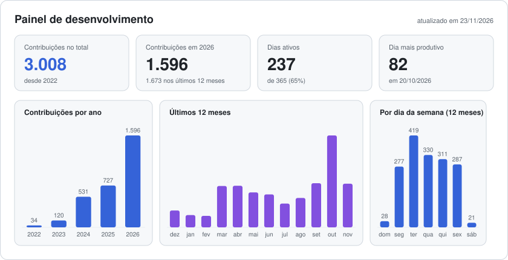
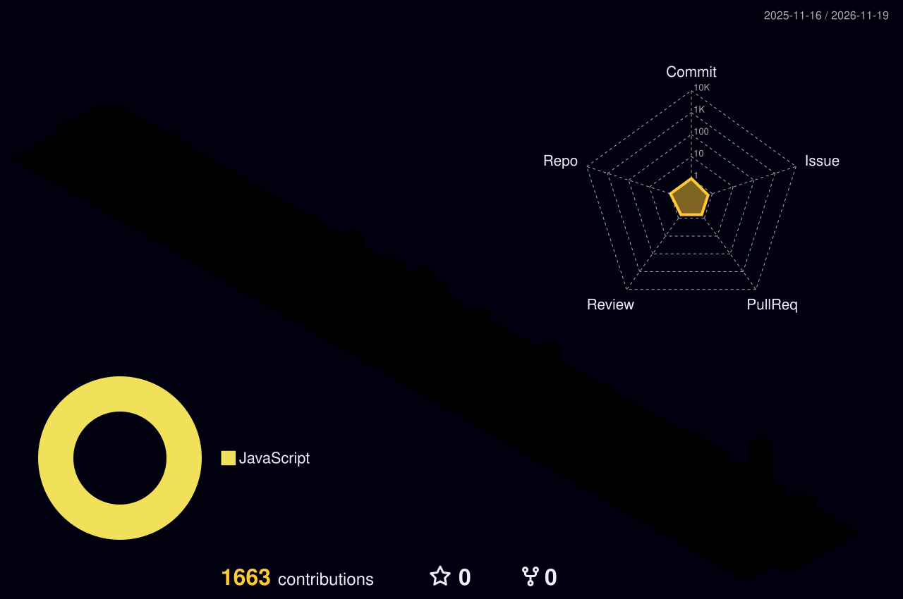

## Sobre mim

**Desenvolvedor Full Stack | Almode — Jaraguá do Sul, SC**

- Atuação no desenvolvimento e evolução de soluções tecnológicas para gestão empresarial, com foco nas necessidades e nos processos do varejo.
- Desenvolvimento de sistemas e funcionalidades integradas, abrangendo PDV, Gestão Fiscal (NF-e e NFC-e), Financeiro, Aplicativo de Vendas, entre outros módulos.
- Participação ativa em todo o ciclo de desenvolvimento de software, desde o levantamento e análise de requisitos até a implementação, monitoramento e evolução das soluções.
- Análise de processos de negócio e transformação de necessidades operacionais em soluções tecnológicas eficientes e escaláveis.
- Identificação e resolução de problemas, manutenção de sistemas, otimização de processos e melhoria contínua da experiência dos usuários.
- Atuação com visão de produto, conectando tecnologia, regras de negócio e necessidades reais dos clientes para entregar soluções que gerem valor ao varejo.

## Stack

  

## Painel

  <picture>
    <source media="(prefers-color-scheme: dark)" srcset="assets/dashboard-dark.svg"/>
    
  </picture>

  
  

  

  <picture>
    <source media="(prefers-color-scheme: dark)" srcset="assets/snake-dark.svg"/>
    
  </picture>

Painel atualizado todo dia por GitHub Actions

